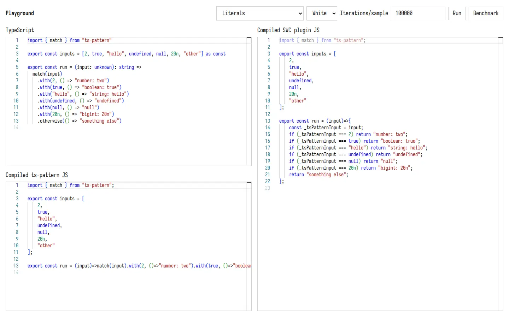

# swc-plugin-ts-pattern

SWC plugin that compiles [`ts-pattern`](https://github.com/gvergnaud/ts-pattern) `match` chains into plain `if`, `switch` and ternary code. Chains that the plugin cannot compile keep the ts-pattern runtime.

- Install and configure: [`plugin/README.md`](plugin/README.md) ([npm](https://www.npmjs.com/package/@scarf005/swc-plugin-ts-pattern))
- Try it in the browser: [playground](https://scarf005.github.io/swc-plugin-ts-pattern/)



## Benchmark

Operations per second from the weekly [`Benchmark` workflow](https://github.com/scarf005/swc-plugin-ts-pattern/actions/workflows/bench.yml). Speedup is plugin output throughput divided by raw `ts-pattern` throughput.


## Repository

| Path                    | Contents                                                                   |
| ----------------------- | -------------------------------------------------------------------------- |
| [`plugin/`](plugin)     | Rust plugin, npm package, Node.js loader and Deno runner                   |
| [`web/`](web)           | Playground and benchmarks                                                  |
| [`examples/`](examples) | Examples from the ts-pattern README, used by the playground and benchmarks |
| [`demo/`](demo)         | Vite React app that installs the local package                             |
| [`vendor/`](vendor)     | ts-pattern and ts-pattern-benchmark submodules                             |

## Development

```sh
git clone --recursive https://github.com/scarf005/swc-plugin-ts-pattern
just test       # lint, format check, plugin, playground and vendored ts-pattern tests
just web        # playground dev server
just fuzz 2000  # compare generated match chains with ts-pattern
just bench      # benchmarks
```

Releases: [`docs/release.md`](docs/release.md).

## License

[AGPL-3.0-only](LICENSE)
