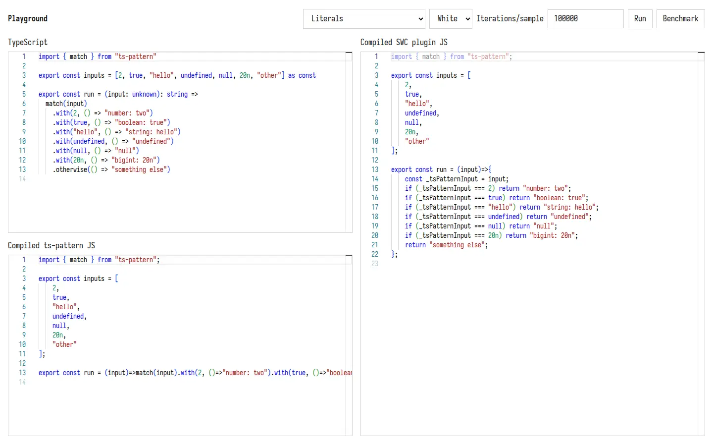

# @scarf005/swc-plugin-ts-pattern

SWC plugin that compiles supported [`ts-pattern`](https://github.com/gvergnaud/ts-pattern) `match` expressions into plain JavaScript ternaries, `switch` statements, or `if` chains.

```ts
import { match, P } from "ts-pattern"

const label = match(input)
  .with({ type: "ok", value: P.number }, (value) => value.value)
  .with({ type: "error" }, () => 0)
  .otherwise(() => -1)
```

The compiled code evaluates the input and calls the handlers like ts-pattern does. Chains that the plugin cannot compile keep the ts-pattern runtime.



## Install

```sh
npm install @scarf005/swc-plugin-ts-pattern @swc/core@~1.15.0 ts-pattern
```

## Configure SWC

Supported versions:

- `@swc/core` 1.15.x (checked 1.15.0 to 1.15.47). Versions 1.14 and earlier and 1.16 cannot load the plugin.
- `ts-pattern` 5.0 to 5.9.
- Node.js 22.15 or later, and Deno 2.9.7 or later.

The package root resolves to the plugin WASM.

```ts
import { transform } from "@swc/core"
import { defaultPluginPath } from "@scarf005/swc-plugin-ts-pattern/transform"

const result = await transform(source, {
  filename: "input.ts",
  jsc: {
    parser: { syntax: "typescript" },
    experimental: { plugins: [[await defaultPluginPath(), {}]] },
  },
})
```

### Find matches that stay on the runtime

The plugin keeps a match on the ts-pattern runtime when it cannot compile it. Set `onFallback` in the plugin options to find these matches:

```ts
experimental: { plugins: [[await defaultPluginPath(), { onFallback: "warn" }]] },
```

- `"warn"` writes `file:line:column: warning: ... (reason)` to stderr for each match. SWC does not show plugin warnings, so the plugin writes them itself.
- `"error"` makes the transform fail and shows each match in the source.

Reasons:

- `unsupported-pattern`: the plugin cannot compile a pattern or arm of the chain.
- `unstable-argument`: a later arm reads a value that code in an earlier arm can change.
- `no-terminal`: the chain does not end in `.otherwise()`, `.exhaustive()` or `.run()`.
- `exhaustive-handler`: `.exhaustive()` gets a spread, more than one argument, or a handler that code in the chain can change.
- `method-<name>`: the chain calls the method `<name>`, which ts-pattern does not define.
- `isMatching`: the plugin cannot compile this `isMatching` call.

## Run TypeScript directly

The loader compiles local `.ts`, `.tsx`, `.mts`, and `.cts` files before evaluation. It uses synchronous `node:module.registerHooks()`. Remote application modules are not transformed. On Node.js, `.ts` and `.tsx` files load as CommonJS when the nearest `package.json` sets `"type": "commonjs"`. Imports of `./foo.js`, `./foo.jsx`, `./foo.mjs`, and `./foo.cjs` resolve to the matching TypeScript source. In a CommonJS file, these imports and imports without an extension need Node.js 24.18 or later on the 24.x line, or 26.2 or later. Earlier versions need the real file name, such as `./foo.ts`.

### Node.js

Install the plugin, `@swc/core`, and ts-pattern:

```sh
npm install ts-pattern @swc/core@~1.15.0 @scarf005/swc-plugin-ts-pattern
```

Preload the loader:

```sh
node --import @scarf005/swc-plugin-ts-pattern/register ./foo.ts
```

### Deno

Use `import { match } from "ts-pattern"` with a `deno.json` import map, or `import { match } from "npm:ts-pattern@5.9.0"`. Run through the CLI:

```sh
deno run -A npm:@scarf005/swc-plugin-ts-pattern/run ./foo.ts
```

The CLI imports the entry as a module. Use preload when your entry relies on native main-module identity (`import.meta.main` or `require.main`).

```sh
deno run -A --preload npm:@scarf005/swc-plugin-ts-pattern/register ./foo.ts
```

Deno requires explicit extensions for relative imports. Import generated `.cts` modules through their default export, then destructure the exported members; Deno cannot discover the SWC-generated named CommonJS exports during static analysis.

For repository-local development, build with `cd plugin && npm ci && npm run build`, then run an example with the `ts-pattern` that `examples/package.json` installs:

```sh
cd examples && npm ci
node --import ../plugin/register.mjs literals.ts
deno run -A --preload ../plugin/register.mjs literals.ts
```

### Programmatic transform

```ts
import { transformTsPattern } from "@scarf005/swc-plugin-ts-pattern/transform"

const result = await transformTsPattern(source, { filename: "foo.ts" })
console.log(result.code)
```

`transformTsPatternSync()` accepts the same options.

Set `SWC_PLUGIN_TS_PATTERN_PATH` to use a custom-built WASM with the loader. For programmatic transforms, pass `pluginPath`. Restart the process after rebuilding a custom WASM: SWC caches loaded plugins for the process lifetime.

## Benchmark

`just bench` compares [`bdbaraban/ts-pattern-benchmark`](https://github.com/bdbaraban/ts-pattern-benchmark) cases across raw `ts-pattern`, native code, and plugin output, then runs the local examples.

The table below shows operations per second from a weekly run of the [`Benchmark` workflow](https://github.com/scarf005/swc-plugin-ts-pattern/actions/workflows/bench.yml). The speedup column is plugin output throughput divided by raw `ts-pattern` throughput.


The full output below comes from the [`Benchmark` workflow](https://github.com/scarf005/swc-plugin-ts-pattern/actions/workflows/bench.yml) on a GitHub-hosted runner; `just update-readme-bench-ci` copies the run for the current commit into this section.

<!-- automd:file src="../docs/just-bench.txt" code lang="text" -->

```text [just-bench.txt]
RUN  v5.1.0 web

 ✓ |unit (bench)| ts-pattern.bench.ts (58 tests) 500466ms
   ✓ ts-pattern-benchmark/always-last-digit 18379ms
     name                              hz     min     max    mean     p75     p99    p995    p999     rme   samples
     native code            21,531,943.92  0.0000  0.1989  0.0000  0.0001  0.0001  0.0001  0.0001  ±0.08%  20980564   fastest
     ts-pattern swc plugin  21,351,596.10  0.0000  0.0536  0.0000  0.0001  0.0001  0.0001  0.0001  ±0.07%  20787244
     ts-pattern raw          1,101,317.16  0.0008  0.2846  0.0009  0.0009  0.0016  0.0018  0.0105  ±0.35%   1058731   slowest
   ✓ ts-pattern-benchmark/random-digit 18216ms
     name                              hz     min     max    mean     p75     p99    p995    p999     rme   samples
     native code            21,237,985.58  0.0000  0.2032  0.0000  0.0001  0.0001  0.0001  0.0001  ±0.08%  20644416   fastest
     ts-pattern swc plugin  21,024,863.81  0.0000  0.0916  0.0000  0.0001  0.0001  0.0001  0.0001  ±0.08%  20396755
     ts-pattern raw          1,913,135.90  0.0002  0.2552  0.0006  0.0008  0.0015  0.0016  0.0056  ±0.31%   1554662   slowest
   ✓ ts-pattern-benchmark/nested-objects 17466ms
     name                              hz     min     max    mean     p75     p99    p995    p999     rme   samples
     ts-pattern swc plugin  20,930,022.13  0.0000  0.0368  0.0000  0.0001  0.0001  0.0001  0.0001  ±0.07%  20367885   fastest
     native code            20,413,715.97  0.0000  0.1461  0.0001  0.0001  0.0001  0.0001  0.0001  ±0.08%  19945783
     ts-pattern raw            435,131.82  0.0019  0.3019  0.0024  0.0025  0.0031  0.0039  0.0122  ±0.19%    424258   slowest
   ✓ intro-html 5570ms
     name                             hz     min     max    mean     p75     p99    p995    p999     rme  samples
     ts-pattern swc plugin  8,770,559.97  0.0000  0.0522  0.0001  0.0001  0.0003  0.0003  0.0004  ±0.07%  7914028   fastest
     ts-pattern raw           573,318.23  0.0010  0.2877  0.0021  0.0029  0.0034  0.0037  0.0125  ±0.21%   477783
   ✓ is-matching-curried 6922ms
     name                              hz     min     max    mean     p75     p99    p995    p999     rme   samples
     ts-pattern swc plugin  11,357,755.41  0.0000  0.2061  0.0001  0.0001  0.0001  0.0002  0.0002  ±0.12%  10652496   fastest
     ts-pattern raw          1,752,064.57  0.0004  0.1577  0.0006  0.0007  0.0008  0.0010  0.0016  ±0.14%   1676390
   ✓ is-matching-direct 7242ms
     name                              hz     min     max    mean     p75     p99    p995    p999     rme   samples
     ts-pattern swc plugin  12,166,094.06  0.0000  0.0523  0.0001  0.0001  0.0001  0.0001  0.0002  ±0.07%  11599780   fastest
     ts-pattern raw          1,770,813.72  0.0004  0.2587  0.0006  0.0007  0.0011  0.0013  0.0034  ±0.18%   1686716
   ✓ literals 8844ms
     name                              hz     min     max    mean     p75     p99    p995    p999     rme   samples
     ts-pattern swc plugin  17,154,196.33  0.0000  0.1944  0.0001  0.0001  0.0001  0.0001  0.0001  ±0.08%  16539998   fastest
     ts-pattern raw          2,175,540.70  0.0002  0.1652  0.0005  0.0006  0.0010  0.0011  0.0017  ±0.22%   1952115
   ✓ matching-several-patterns 9645ms
     name                              hz     min     max    mean     p75     p99    p995    p999     rme   samples
     ts-pattern swc plugin  16,791,689.90  0.0000  0.2030  0.0001  0.0001  0.0001  0.0001  0.0001  ±0.08%  16187044   fastest
     ts-pattern raw          1,960,201.07  0.0002  0.3567  0.0005  0.0006  0.0010  0.0012  0.0017  ±0.27%   1820854
   ✓ objects 6546ms
     name                              hz     min      max    mean     p75     p99    p995    p999      rme   samples
     ts-pattern swc plugin  11,383,400.60  0.0000  67.2349  0.0001  0.0001  0.0003  0.0003  0.0004  ±12.51%  10004450   fastest
     ts-pattern raw          1,252,124.71  0.0005   0.3049  0.0010  0.0012  0.0016  0.0018  0.0100   ±0.21%   1031176
   ✓ p-array-patterns 7193ms
     name                              hz     min     max    mean     p75     p99    p995    p999     rme   samples
     ts-pattern swc plugin  13,799,446.04  0.0000  1.8105  0.0001  0.0001  0.0002  0.0002  0.0002  ±0.36%  12197303   fastest
     ts-pattern raw            616,111.69  0.0013  0.3003  0.0017  0.0020  0.0034  0.0037  0.0114  ±0.24%    582200
   ✓ p-bigint-wildcard 12136ms
     name                              hz     min     max    mean     p75     p99    p995    p999     rme   samples
     ts-pattern swc plugin  21,011,978.12  0.0000  0.0332  0.0000  0.0001  0.0001  0.0001  0.0001  ±0.07%  20363019   fastest
     ts-pattern raw          7,142,603.96  0.0001  0.4665  0.0001  0.0001  0.0002  0.0003  0.0005  ±0.18%   6934975
   ✓ p-boolean-wildcard 10498ms
     name                              hz     min     max    mean     p75     p99    p995    p999     rme   samples
     ts-pattern swc plugin  20,005,017.94  0.0000  0.1093  0.0001  0.0001  0.0001  0.0001  0.0001  ±0.07%  19476987   fastest
     ts-pattern raw          3,914,650.35  0.0002  0.2329  0.0003  0.0003  0.0006  0.0007  0.0010  ±0.25%   3635901
   ✓ p-infer 6770ms
     name                              hz     min     max    mean     p75     p99    p995    p999     rme   samples
     ts-pattern swc plugin  12,266,708.80  0.0000  0.4376  0.0001  0.0001  0.0001  0.0001  0.0002  ±0.17%  11351958   fastest
     ts-pattern raw            566,080.89  0.0012  0.3209  0.0021  0.0028  0.0039  0.0051  0.0125  ±0.24%    483229
   ✓ p-instanceof-patterns 7441ms
     name                              hz     min     max    mean     p75     p99    p995    p999     rme   samples
     ts-pattern swc plugin  14,104,122.59  0.0000  0.0366  0.0001  0.0001  0.0001  0.0001  0.0002  ±0.07%  13343155   fastest
     ts-pattern raw            630,601.83  0.0013  0.2435  0.0016  0.0018  0.0023  0.0026  0.0111  ±0.22%    610204
   ✓ p-intersection-patterns 6523ms
     name                              hz     min     max    mean     p75     p99    p995    p999     rme   samples
     ts-pattern swc plugin  11,605,633.98  0.0001  0.0390  0.0001  0.0001  0.0001  0.0001  0.0002  ±0.07%  11123319   fastest
     ts-pattern raw            341,243.23  0.0026  0.2030  0.0030  0.0034  0.0040  0.0058  0.0133  ±0.19%    331785
   ✓ p-map-patterns 6983ms
     name                              hz     min     max    mean     p75     p99    p995    p999     rme   samples
     ts-pattern swc plugin  12,865,558.07  0.0000  0.2383  0.0001  0.0001  0.0001  0.0002  0.0005  ±0.17%  12140503   fastest
     ts-pattern raw            437,202.84  0.0019  0.2304  0.0023  0.0024  0.0033  0.0042  0.0122  ±0.18%    426604
   ✓ p-narrow 5054ms
     name                             hz     min     max    mean     p75     p99    p995    p999     rme  samples
     ts-pattern swc plugin  9,064,604.53  0.0001  0.2680  0.0002  0.0002  0.0029  0.0029  0.0030  ±0.21%  5177357   fastest
     ts-pattern raw         2,011,617.34  0.0003  0.1602  0.0006  0.0006  0.0033  0.0033  0.0039  ±0.18%  1700028
   ✓ p-nonnullable-wildcard 11814ms
     name                              hz     min     max    mean     p75     p99    p995    p999     rme   samples
     ts-pattern swc plugin  20,919,147.07  0.0000  0.0373  0.0000  0.0001  0.0001  0.0001  0.0001  ±0.07%  20257200   fastest
     ts-pattern raw          7,255,473.17  0.0001  0.4204  0.0001  0.0001  0.0003  0.0004  0.0006  ±0.28%   6910417
   ✓ p-not-patterns 10513ms
     name                              hz     min     max    mean     p75     p99    p995    p999     rme   samples
     ts-pattern swc plugin  20,160,968.18  0.0000  0.0375  0.0001  0.0001  0.0001  0.0001  0.0001  ±0.07%  19383133   fastest
     ts-pattern raw          1,212,350.76  0.0007  0.2359  0.0009  0.0009  0.0018  0.0020  0.0045  ±0.20%   1164164
   ✓ p-nullish-wildcard 11092ms
     name                              hz     min     max    mean     p75     p99    p995    p999     rme   samples
     ts-pattern swc plugin  20,076,483.46  0.0000  0.0493  0.0001  0.0001  0.0001  0.0001  0.0001  ±0.07%  19384996   fastest
     ts-pattern raw          5,289,772.84  0.0001  0.2999  0.0002  0.0002  0.0004  0.0006  0.0009  ±0.25%   4987254
   ✓ p-number-between 9691ms
     name                              hz     min     max    mean     p75     p99    p995    p999     rme   samples
     ts-pattern swc plugin  20,480,449.53  0.0000  0.0371  0.0001  0.0001  0.0001  0.0001  0.0001  ±0.07%  19762747   fastest
     ts-pattern raw            772,196.79  0.0012  0.2159  0.0013  0.0013  0.0020  0.0023  0.0108  ±0.18%    755888
   ✓ p-number-finite 9777ms
     name                              hz     min     max    mean     p75     p99    p995    p999     rme   samples
     ts-pattern swc plugin  20,675,355.80  0.0000  0.2362  0.0001  0.0001  0.0001  0.0001  0.0001  ±0.09%  19947089   fastest
     ts-pattern raw            791,799.47  0.0011  0.2287  0.0013  0.0013  0.0017  0.0019  0.0107  ±0.18%    776192
   ✓ p-number-gt 9636ms
     name                              hz     min     max    mean     p75     p99    p995    p999     rme   samples
     ts-pattern swc plugin  20,520,320.21  0.0000  0.0692  0.0001  0.0001  0.0001  0.0001  0.0001  ±0.07%  19739289   fastest
     ts-pattern raw            794,371.56  0.0011  0.1840  0.0013  0.0013  0.0017  0.0021  0.0107  ±0.17%    778977
   ✓ p-number-gte 9198ms
     name                              hz     min     max    mean     p75     p99    p995    p999     rme   samples
     ts-pattern swc plugin  19,051,010.72  0.0000  0.1712  0.0001  0.0001  0.0001  0.0001  0.0001  ±0.08%  18289381   fastest
     ts-pattern raw            792,316.58  0.0011  0.2324  0.0013  0.0013  0.0017  0.0019  0.0108  ±0.18%    776859
   ✓ p-number-int 9399ms
     name                              hz     min     max    mean     p75     p99    p995    p999     rme   samples
     ts-pattern swc plugin  19,851,301.23  0.0000  0.0390  0.0001  0.0001  0.0001  0.0001  0.0001  ±0.06%  18998795   fastest
     ts-pattern raw            799,513.51  0.0011  0.2981  0.0013  0.0013  0.0019  0.0022  0.0108  ±0.23%    780561
   ✓ p-number-lt 9663ms
     name                              hz     min     max    mean     p75     p99    p995    p999     rme   samples
     ts-pattern swc plugin  20,668,960.12  0.0000  0.1487  0.0000  0.0001  0.0001  0.0001  0.0001  ±0.07%  20004884   fastest
     ts-pattern raw            788,109.26  0.0012  0.3225  0.0013  0.0013  0.0018  0.0021  0.0108  ±0.18%    772867
   ✓ p-number-lte 9461ms
     name                              hz     min     max    mean     p75     p99    p995    p999     rme   samples
     ts-pattern swc plugin  20,165,952.32  0.0000  0.0414  0.0001  0.0001  0.0001  0.0001  0.0001  ±0.07%  19440265   fastest
     ts-pattern raw            793,336.13  0.0011  0.2821  0.0013  0.0013  0.0017  0.0020  0.0107  ±0.21%    776736
   ✓ p-number-negative 8939ms
     name                              hz     min     max    mean     p75     p99    p995    p999     rme   samples
     ts-pattern swc plugin  18,549,868.65  0.0000  0.0380  0.0001  0.0001  0.0001  0.0001  0.0001  ±0.07%  17721339   fastest
     ts-pattern raw            787,574.73  0.0012  0.2361  0.0013  0.0013  0.0017  0.0019  0.0108  ±0.19%    772035
   ✓ p-number-positive 9471ms
     name                              hz     min     max    mean     p75     p99    p995    p999     rme   samples
     ts-pattern swc plugin  20,368,637.18  0.0000  0.0417  0.0001  0.0001  0.0001  0.0001  0.0001  ±0.07%  19728295   fastest
     ts-pattern raw            794,078.50  0.0011  0.2717  0.0013  0.0013  0.0018  0.0020  0.0108  ±0.21%    777302
   ✓ p-number-wildcard 11040ms
     name                              hz     min     max    mean     p75     p99    p995    p999     rme   samples
     ts-pattern swc plugin  20,334,534.72  0.0000  0.0359  0.0001  0.0001  0.0001  0.0001  0.0001  ±0.07%  19681093   fastest
     ts-pattern raw          5,094,667.59  0.0001  0.3352  0.0002  0.0002  0.0004  0.0005  0.0008  ±0.20%   4788480
   ✓ p-optional-patterns 7469ms
     name                              hz     min     max    mean     p75     p99    p995    p999     rme   samples
     ts-pattern swc plugin  13,912,919.81  0.0000  0.0528  0.0001  0.0001  0.0001  0.0001  0.0002  ±0.07%  13214863   fastest
     ts-pattern raw            614,116.95  0.0014  0.2162  0.0017  0.0019  0.0024  0.0031  0.0110  ±0.19%    594688
   ✓ p-pattern 8163ms
     name                              hz     min     max    mean     p75     p99    p995    p999     rme   samples
     ts-pattern swc plugin  13,990,263.37  0.0000  0.0540  0.0001  0.0001  0.0001  0.0001  0.0002  ±0.07%  13465727   fastest
     ts-pattern raw          2,352,100.07  0.0004  0.4056  0.0004  0.0004  0.0007  0.0008  0.0013  ±0.14%   2305646
   ✓ p-record-profiles 3877ms
     name                             hz     min     max    mean     p75     p99    p995    p999     rme  samples
     ts-pattern swc plugin  3,168,116.18  0.0002  1.1709  0.0003  0.0003  0.0006  0.0007  0.0012  ±0.35%  3016462   fastest
     ts-pattern raw           585,940.94  0.0013  0.3210  0.0018  0.0020  0.0028  0.0034  0.0126  ±0.24%   556379
   ✓ p-record-scores 3679ms
     name                             hz     min     max    mean     p75     p99    p995    p999     rme  samples
     ts-pattern swc plugin  2,779,045.91  0.0002  0.3123  0.0004  0.0005  0.0009  0.0011  0.0015  ±0.25%  2438862   fastest
     ts-pattern raw           495,095.18  0.0015  0.2830  0.0021  0.0023  0.0031  0.0036  0.0121  ±0.25%   475440
   ✓ p-record-select 3073ms
     name                             hz     min     max    mean     p75     p99    p995    p999     rme  samples
     ts-pattern swc plugin  1,348,703.26  0.0005  0.3729  0.0008  0.0009  0.0011  0.0015  0.0029  ±0.29%  1254319   fastest
     ts-pattern raw           197,034.03  0.0034  0.2967  0.0055  0.0065  0.0075  0.0145  0.0178  ±0.24%   181716
   ✓ p-select-anonymous 6807ms
     name                              hz     min     max    mean     p75     p99    p995    p999     rme   samples
     ts-pattern swc plugin  11,449,425.99  0.0000  0.0548  0.0001  0.0001  0.0001  0.0001  0.0002  ±0.07%  10915861   fastest
     ts-pattern raw            792,047.63  0.0009  0.3143  0.0014  0.0016  0.0019  0.0024  0.0109  ±0.25%    734391
   ✓ p-select-guarded 5772ms
     name                             hz     min     max    mean     p75     p99    p995    p999     rme  samples
     ts-pattern swc plugin  9,985,803.22  0.0001  0.0511  0.0001  0.0001  0.0002  0.0002  0.0002  ±0.07%  9350622   fastest
     ts-pattern raw           210,518.25  0.0041  0.3011  0.0049  0.0051  0.0074  0.0137  0.0177  ±0.26%   204899
   ✓ p-select-named 5279ms
     name                             hz     min     max    mean     p75     p99    p995    p999     rme  samples
     ts-pattern swc plugin  9,777,567.25  0.0000  0.0341  0.0001  0.0001  0.0009  0.0009  0.0009  ±0.09%  7341592   fastest
     ts-pattern raw           571,841.80  0.0013  0.2414  0.0019  0.0023  0.0032  0.0038  0.0118  ±0.20%   522697
   ✓ p-set-patterns 7548ms
     name                              hz     min     max    mean     p75     p99    p995    p999     rme   samples
     ts-pattern swc plugin  15,646,400.55  0.0000  0.2186  0.0001  0.0001  0.0001  0.0001  0.0002  ±0.13%  14435046   fastest
     ts-pattern raw            546,899.49  0.0016  0.3010  0.0019  0.0020  0.0027  0.0033  0.0115  ±0.23%    528746
   ✓ p-string-endswith 9081ms
     name                              hz     min     max    mean     p75     p99    p995    p999     rme   samples
     ts-pattern swc plugin  19,532,980.39  0.0000  0.0560  0.0001  0.0001  0.0001  0.0001  0.0001  ±0.07%  18665516   fastest
     ts-pattern raw            724,490.59  0.0013  0.2562  0.0014  0.0014  0.0019  0.0022  0.0107  ±0.18%    710530
   ✓ p-string-includes 8564ms
     name                              hz     min     max    mean     p75     p99    p995    p999     rme   samples
     ts-pattern swc plugin  18,602,123.21  0.0000  0.0775  0.0001  0.0001  0.0001  0.0001  0.0002  ±0.07%  17225360   fastest
     ts-pattern raw            725,420.41  0.0012  0.3466  0.0014  0.0014  0.0021  0.0024  0.0108  ±0.29%    707091
   ✓ p-string-length 9268ms
     name                              hz     min     max    mean     p75     p99    p995    p999     rme   samples
     ts-pattern swc plugin  20,393,420.65  0.0000  0.0495  0.0001  0.0001  0.0001  0.0001  0.0001  ±0.07%  19661632   fastest
     ts-pattern raw            733,084.27  0.0012  0.2955  0.0014  0.0014  0.0020  0.0022  0.0107  ±0.22%    718118
   ✓ p-string-maxlength 9223ms
     name                              hz     min     max    mean     p75     p99    p995    p999     rme   samples
     ts-pattern swc plugin  20,215,985.14  0.0000  0.0420  0.0001  0.0001  0.0001  0.0001  0.0001  ±0.07%  19478351   fastest
     ts-pattern raw            741,429.18  0.0012  0.2204  0.0014  0.0014  0.0018  0.0021  0.0107  ±0.18%    727196
   ✓ p-string-minlength 9222ms
     name                              hz     min      max    mean     p75     p99    p995    p999      rme   samples
     ts-pattern swc plugin  20,147,106.32  0.0000   0.1044  0.0001  0.0001  0.0001  0.0001  0.0001   ±0.09%  19327977   fastest
     ts-pattern raw            725,751.07  0.0013  66.4723  0.0015  0.0014  0.0024  0.0029  0.0110  ±13.03%    659189
   ✓ p-string-regex 7977ms
     name                              hz     min     max    mean     p75     p99    p995    p999     rme   samples
     ts-pattern swc plugin  16,759,085.86  0.0000  2.0527  0.0001  0.0001  0.0001  0.0001  0.0002  ±0.42%  14893902   fastest
     ts-pattern raw            717,857.33  0.0012  0.2428  0.0014  0.0015  0.0023  0.0026  0.0110  ±0.21%    699812
   ✓ p-string-startswith 9183ms
     name                              hz     min     max    mean     p75     p99    p995    p999     rme   samples
     ts-pattern swc plugin  19,710,991.56  0.0000  0.0643  0.0001  0.0001  0.0001  0.0001  0.0001  ±0.07%  18918286   fastest
     ts-pattern raw            717,640.06  0.0013  0.2172  0.0014  0.0014  0.0023  0.0025  0.0109  ±0.20%    701163
   ✓ p-string-wildcard 10546ms
     name                              hz     min     max    mean     p75     p99    p995    p999     rme   samples
     ts-pattern swc plugin  19,727,939.20  0.0000  0.0434  0.0001  0.0001  0.0001  0.0001  0.0001  ±0.07%  19067210   fastest
     ts-pattern raw          4,733,075.38  0.0001  0.3241  0.0002  0.0002  0.0004  0.0005  0.0008  ±0.13%   4498017
   ✓ p-symbol-wildcard 11408ms
     name                              hz     min     max    mean     p75     p99    p995    p999     rme   samples
     ts-pattern swc plugin  19,718,719.75  0.0000  0.1949  0.0001  0.0001  0.0001  0.0001  0.0001  ±0.08%  19071153   fastest
     ts-pattern raw          7,219,356.11  0.0001  0.3398  0.0001  0.0001  0.0003  0.0004  0.0007  ±0.27%   6868794
   ✓ p-union-patterns 6951ms
     name                              hz     min     max    mean     p75     p99    p995    p999     rme   samples
     ts-pattern swc plugin  11,917,389.22  0.0001  0.0703  0.0001  0.0001  0.0001  0.0001  0.0002  ±0.07%  11549187   fastest
     ts-pattern raw            715,893.27  0.0011  0.4196  0.0015  0.0020  0.0027  0.0030  0.0160  ±0.25%    652848
   ✓ p-when-patterns 4699ms
     name                             hz     min     max    mean     p75     p99    p995    p999     rme  samples
     ts-pattern swc plugin  9,740,590.12  0.0000  0.1452  0.0002  0.0001  0.0022  0.0022  0.0023  ±0.16%  5654077   fastest
     ts-pattern raw           632,053.42  0.0011  0.2342  0.0017  0.0017  0.0039  0.0040  0.0114  ±0.18%   601408
   ✓ p-wildcard 12108ms
     name                              hz     min     max    mean     p75     p99    p995    p999     rme   samples
     ts-pattern swc plugin  21,984,661.06  0.0000  0.2450  0.0000  0.0001  0.0001  0.0001  0.0001  ±0.08%  21361091   fastest
     ts-pattern raw          7,431,232.75  0.0001  0.2866  0.0001  0.0001  0.0003  0.0004  0.0006  ±0.29%   7053906
   ✓ patterns-p 9482ms
     name                              hz     min     max    mean     p75     p99    p995    p999     rme   samples
     ts-pattern swc plugin  18,943,202.87  0.0000  0.0416  0.0001  0.0001  0.0002  0.0002  0.0002  ±0.07%  16449233   fastest
     ts-pattern raw          3,488,817.76  0.0002  0.2372  0.0003  0.0003  0.0006  0.0007  0.0011  ±0.24%   3258944
   ✓ patterns-pattern 9517ms
     name                              hz     min     max    mean     p75     p99    p995    p999     rme   samples
     ts-pattern swc plugin  18,745,163.34  0.0000  0.1479  0.0001  0.0001  0.0002  0.0002  0.0002  ±0.09%  16455413   fastest
     ts-pattern raw          3,282,731.04  0.0002  0.2411  0.0003  0.0003  0.0007  0.0008  0.0012  ±0.26%   3091588
   ✓ state-reducer 5536ms
     name                             hz     min     max    mean     p75     p99    p995    p999     rme  samples
     ts-pattern swc plugin  7,667,402.59  0.0001  0.5281  0.0001  0.0002  0.0003  0.0003  0.0004  ±0.13%  6779049   fastest
     ts-pattern raw           307,117.75  0.0021  0.2268  0.0035  0.0042  0.0054  0.0075  0.0148  ±0.20%   281767
   ✓ tuples-arrays 6211ms
     name                              hz     min     max    mean     p75     p99    p995    p999     rme  samples
     ts-pattern swc plugin  12,510,114.15  0.0000  1.3658  0.0001  0.0001  0.0004  0.0004  0.0005  ±0.28%  9560445   fastest
     ts-pattern raw          1,015,836.61  0.0006  0.2137  0.0011  0.0012  0.0016  0.0018  0.0105  ±0.19%   945157
   ✓ type-guard-function 7598ms
     name                              hz     min     max    mean     p75     p99    p995    p999     rme   samples
     ts-pattern swc plugin  14,192,760.80  0.0000  0.1796  0.0001  0.0001  0.0001  0.0001  0.0002  ±0.08%  13689069   fastest
     ts-pattern raw            751,219.85  0.0011  0.2420  0.0014  0.0016  0.0021  0.0027  0.0107  ±0.17%    723086
   ✓ type-narrowing-select 3590ms
     name                             hz     min     max    mean     p75     p99    p995    p999     rme  samples
     ts-pattern swc plugin  3,757,979.73  0.0001  0.0356  0.0004  0.0004  0.0041  0.0042  0.0044  ±0.17%  2532824   fastest
     ts-pattern raw           326,150.95  0.0022  0.2609  0.0032  0.0033  0.0079  0.0086  0.0143  ±0.20%   310174
   ✓ type-narrowing 7505ms
     name                              hz     min     max    mean     p75     p99    p995    p999     rme   samples
     ts-pattern swc plugin  13,713,646.28  0.0000  0.0272  0.0001  0.0001  0.0001  0.0001  0.0002  ±0.07%  13263608   fastest
     ts-pattern raw          1,381,130.13  0.0004  0.2484  0.0008  0.0012  0.0013  0.0016  0.0044  ±0.21%   1192303

 Test Files  1 passed (1)
      Tests  58 passed (58)
   Start at  05:03:39
   Duration  509.99s (tests 98%, import 2%)
```

<!-- /automd -->

## Supported input

The transformer handles chains that start from `match(value)` imported from `ts-pattern` and end in `.otherwise(handler)`, `.exhaustive()`, `.exhaustive(handler)` or `.run()`. When no arm matches, `.exhaustive()` and `.run()` call the ts-pattern runtime with the input, so it throws its own error. It also compiles `isMatching(pattern)` and `isMatching(pattern, value)` when the pattern holds only literals and side-effect-free inline callbacks and `value` is an identifier or literal.

Supported patterns:

- primitive literals: string, number, bigint, boolean, `null`, `undefined`
- object and array literal patterns, including one `...P.array(pattern?)` spread in an array
- `P._`, `P.any`
- `P.string`, `P.number`, `P.boolean`, `P.bigint`, `P.symbol`, `P.nullish`, `P.nonNullable`
- `P.optional(pattern)`, `P.not(pattern)`, `P.union(...patterns)`, `P.array(pattern?)`, `P.instanceOf(Ctor)`, `P.when(predicate)`
- chained `.optional()`, `.and(pattern)`, and `.or(pattern)` on patterns that provide them

Supported selection patterns include `P.select` and array/record selection aggregation. Record key selections preserve numeric coercion and original-key matching. Selections named `__proto__`, and record selections using inherited `Object.prototype` names such as `constructor` or `toString`, retain the runtime to preserve its selection and error behavior. The plugin also handles `.when`, `P.set`, `P.map`, `P.record`, `P.intersection`, and common string, number and bigint refinements.

`.narrow()` compiles away like `.returnType()`. ts-pattern 5.0-5.7 do not define it, so there the raw chain throws a `TypeError` and the compiled chain does not. Unsupported chains, custom matcher objects, and unsupported combinations are left unchanged to preserve runtime behavior. Keep ts-pattern installed even when most expressions compile.
